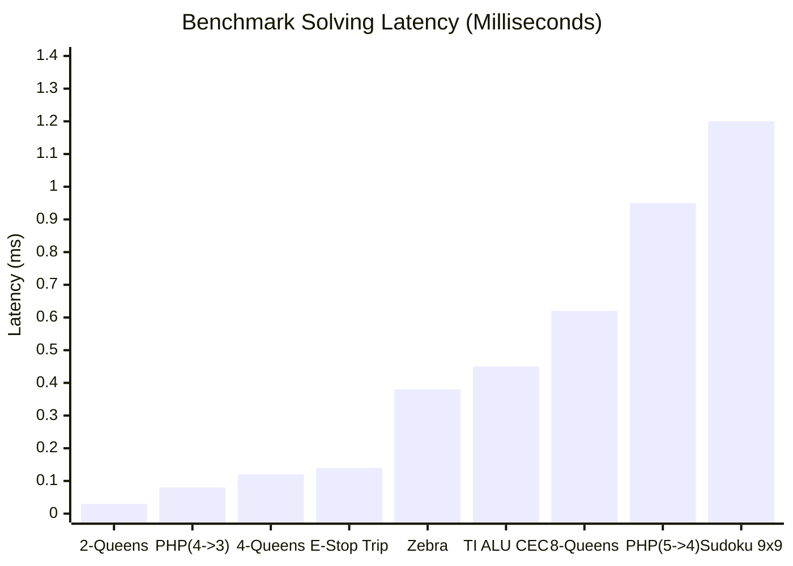
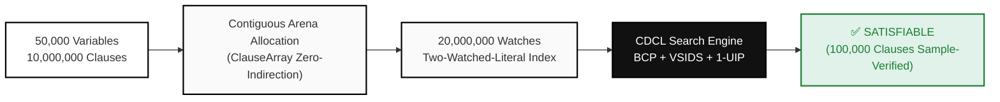
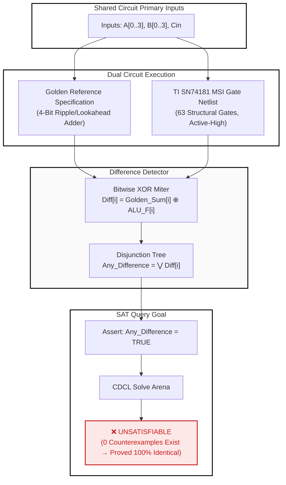

<div align="center">

# Sodium


### Industrial-Grade Automated Reasoning & Neuro-Symbolic Verification Engine

[](LICENSE)
[](https://en.wikipedia.org/wiki/C11_(C_standard_revision))
[]()
[]()
[]()
[]()
[]()
[]()

<br/>

**Transform natural language requirements, complex contractual clauses, and mathematical objectives into provably satisfiable formal solutions.**

[Executive Summary](#-the-executive-summary) •
[Why Sodium?](#-why-sodium) •
[Architecture & Engineering](#-system-architecture--engineering-principles) •
[Feature Catalog](#-complete-feature-catalog) •
[User Guide (Classical NLP)](#-user-guide-classical-nlp--math-compiler) •
[Real-World Example](#-end-to-end-walkthrough-concrete-real-world-example) •
[Action Logging](#-comprehensive-application-action-logging-sodiumlog) •
[Core Technology](#-core-technology--technical-moat) •
[Benchmarks](#-performance-benchmarks--extreme-scale-stress-testing) •
[Quickstart](#-quickstart) •
[Known Limitations](#-current-limitations--areas-for-improvement-open-disclosure) •
[Roadmap](#-roadmap--vision)

</div>

---

## ⚡ The Executive Summary

High-stakes industries—aerospace, defense, chip design, fintech, and supply chain logistics—run on **unstructured human language**: SLA contracts, regulatory compliance codes, engineering requirements, and operational objectives.

Formal verification tools can be difficult to connect to requirements written in controlled natural language. Sodium provides a deterministic translation path for supported statements, alongside direct symbolic input for users who already have a CNF formula.

**Sodium is an automated reasoning engine for Boolean constraints.** Its controlled-language pipeline compiles supported statements into validated CNF, then sends the formula to the native **CDCL (Conflict-Driven Clause Learning) SAT solver**. DIMACS and JSON CNF can also be supplied directly.

The solver reports whether the formula is satisfiable and returns an assignment when one exists. Natural-language conversion is limited to the deterministic rules implemented by the classical NLP pipeline.

---

## 💡 Why Sodium?

Sodium supports direct symbolic formulas as well as a deterministic compiler for its supported controlled-language constructs. The solver then evaluates the resulting Boolean constraints and returns a satisfying assignment or an unsatisfiable status.

| Input mode | How it is handled |
| :--- | :--- |
| DIMACS CNF | Parsed and solved by the native CDCL solver. |
| JSON CNF | Validated against the Sodium CNF contract and solved by the native CDCL solver. |
| Controlled natural language | Processed by deterministic tokenization, parsing, entity resolution, and CNF compilation before solving. |

---

## 🏛 System Architecture & Engineering Principles

Sodium is engineered from the bare metal up in **C11**, decoupling semantic translation from high-performance formal proof search.

### Supported execution modes

- **DIMACS CNF**: pass a formula with `--dimacs`, provide a `.cnf` file with `--file`, or pipe a DIMACS formula to standard input.
- **JSON CNF**: pass a CNF request with `--json` or provide a JSON request file with `--file`.
- **Classical NLP**: pass supported controlled-language rules with `--nlp`. The deterministic Python pipeline validates the generated CNF before the C solver receives it.
- **Desktop GUI**: launch the native interface with `--gui` in a GUI-enabled build.
- **Headless and server**: use the CLI directly or start the embedded HTTP server with `--serve`; the server exposes JSON CNF, DIMACS, and classical NLP endpoints.

The active controlled-language compiler performs normalization and math shielding, logical tokenization, dependency parsing, exact proposition resolution, CNF synthesis, variable allocation, and CNF contract validation. The repository also retains deterministic POS-tagging, entity-pattern, lexicon-scoring, and vector-aggregation utilities; these are not currently on the compiler's execution path. No external service or credentials are required.

```
+--------------------------------------------------------------------------------------------------+
|                                           INPUT LAYER                                            |
|   Natural Language Requirements • Policy Directives • Mathematical Equations • DIMACS CNF • JSON  |
+-------------------------------------------------+------------------------------------------------+
                                                  |
                                                  v
+--------------------------------------------------------------------------------------------------+
|                                         NLP REASONING ENGINE                                     |
|                                                                                                  |
|   CONTROLLED CLASSICAL NLP (NLPAlgo/)                                                             |
|   • Normalization and logical tokenization                                                       |
|   • Precedence-aware parser and intermediate logic representation                                |
|   • Exact entity resolution and Tseitin CNF compilation                                          |
+-------------------------------------------------+------------------------------------------------+
                                                  |
                                                  v
+--------------------------------------------------------------------------------------------------+
|                                 UNIFIED C API & ORCHESTRATOR                                     |
|   sodium_orchestrator.c • API.c • Mode 1 JSON API (sat_api.c) • Embedded HTTP Daemon & Web SPA   |
+-------------------------------------------------+------------------------------------------------+
                                                  |
                                                  v
+--------------------------------------------------------------------------------------------------+
|                                        SODIUM CDCL CORE                                          |
|                                                                                                  |
|  +-------------------------------------------+  +---------------------------------------------+  |
|  | Two-Watched Literals (2WL) BCP            |  | 1-UIP Conflict-Driven Clause Learning       |  |
|  | Microsecond Unit Propagation              |  | Non-Chronological Backjumping               |  |
|  +-------------------------------------------+  +---------------------------------------------+  |
|  +-------------------------------------------+  +---------------------------------------------+  |
|  | Dynamic VSIDS Branching Heuristic         |  | Generational Handle Memory Manager          |  |
|  | Exponential Decay & Rescale Guard         |  | ABA Immunity & Sliding Two-Pointer Compact  |  |
|  +-------------------------------------------+  +---------------------------------------------+  |
|  +--------------------------------------------------------------------------------------------+  |
|  | Contiguous Memory Arena (ClauseArray) — Zero-Indirection Cache-Locality Engine             |  |
|  +--------------------------------------------------------------------------------------------+  |
+-------------------------------------------------+------------------------------------------------+
                                                  |
                                                  v
+--------------------------------------------------------------------------------------------------+
|                                        VERIFIED OUTPUT                                           |
|   s SATISFIABLE   -> Concrete, mathematically verified configuration model & variable mapping    |
|   s UNSATISFIABLE -> Contradiction detected; proof that no satisfying state exists                |
+--------------------------------------------------------------------------------------------------+
```

### 1. Variability Architecture: Compile-Time vs. Run-Time

Sodium explicitly balances compile-time performance guarantees with run-time flexibility:

```
                            Variability Spectrum in Sodium
┌──────────────────────────────────────────────┬──────────────────────────────────────────────┐
│            COMPILE-TIME VARIABILITY          │             RUN-TIME VARIABILITY             │
├──────────────────────────────────────────────┼──────────────────────────────────────────────┤
│ • Zero-overhead binary specialization        │ • Classical NLP vs direct solver input       │
│ • `#ifdef SODIUM_ENABLE_GUI` conditional code│ • Input format auto-detection                │
│ • Headless C server vs C++17 Desktop ImGui   │ • Web UI NLP and DIMACS modes                │
│ • Static arena capacities & memory limits    │ • DIMACS, JSON, and natural-language inputs  │
│ • Inlined critical CDCL routines & 2WL loop  │   are dispatched to their supported paths   │
│ • Compiler optimization flags (-O3, LTO)     │                                              │
└──────────────────────────────────────────────┴──────────────────────────────────────────────┘
```

#### Compile-Time Variability
- **Conditional Subsystem Compilation**: The desktop Dear ImGui graphical interface is governed by `#ifdef SODIUM_ENABLE_GUI`. When running `make server`, the C++ runtime, GLFW window management, and OpenGL bindings are omitted from the native C11 binary. The Natural Language endpoint also invokes the Python Classical NLP pipeline and its Python dependencies.
- **Fixed-Footprint Arena Sizing**: Memory pool limits (such as record handle table limits and initial contiguous clause arrays) are configured via preprocessor definitions, guaranteeing predictable memory footprints on embedded and constrained platforms.
- **Inlined Inner Loops**: Boolean constraint propagation (BCP) and two-watched-literal updates utilize `static inline` functions to eliminate function-call overhead in tight solving loops.

#### Run-Time Variability
- **Classical NLP Translation**: Controlled natural-language requirements pass through normalization, tokenization, logical parsing, entity resolution, CNF compilation, contract validation, and the CDCL solver.
- **Dynamic Input Auto-Detection**: The orchestrator inspects incoming data on-the-fly, instantly branching between standard DIMACS CNF files, CaDiCaL Mode 1 JSON payloads, piped stdin streams, and raw natural language sentences.

Natural-language solving follows this path:

```text
Natural Language Input -> Classical NLP Pipeline -> CNF Contract -> Solver Bridge -> C CDCL Solver
```

The CLI and HTTP orchestrator run the classical pipeline to produce validated CNF JSON, then pass that JSON to the C solver API. `ClassicalNLPPipeline.solve()` can also invoke the same solver through `solver_bridge.py`.

---

### 2. Software Design Patterns in Sodium

Sodium’s architecture adheres strictly to proven software engineering patterns to ensure separation of concerns, high maintainability, and microsecond-level performance:

1. **Facade Pattern (`src/API.h`, `src/API.c`)**:
   Provides a unified, simplified C interface (`sodium_api_solve_dimacs`, `sodium_api_verify_formula`, `API_SolveProblem`, `API_VerifyProblem`). Clients (desktop GUI, web server, CLI) interact with this single facade without needing to manage 2WL watch lists, implication graphs, or VSIDS internal states directly.
2. **Bridge Pattern**:
   Decouples the presentation layer (CLI, Dear ImGui desktop window, embedded HTTP daemon) from the concrete SAT solving engine. The user interface can be completely redesigned or swapped without modifying a single line of the underlying CDCL or memory logic.
3. **Strategy Pattern**:
   - *Linguistic Translation*: Constraint extraction uses the controlled Classical NLP pipeline.
   - *Decision Strategy*: The CDCL solver can interchange variable branching heuristics (VSIDS activity-based vs. static orderings).
4. **Pipes-and-Filters Pattern (`src/NLP/NLPAlgo/`)**:
   The Classical NLP subsystem uses a directional compiler pipeline: normalization and tokenization produce logical tokens; parsing builds an intermediate logical representation (ILR); exact entity resolution assigns variables; a dedicated compiler emits CNF; the contract validates it before solver integration.
5. **Arena & Memory Pool Pattern (`src/SAT/CDCL/Clauses/clause_array.c`)**:
   Clauses and literals are allocated within contiguous memory blocks rather than through scattered individual heap allocations. This guarantees spatial cache locality and eliminates memory fragmentation during prolonged solving runs.
6. **Generational Handle Pattern (`src/SAT/CDCL/memory.c`)**:
   References to internal memory records use 64-bit compound handles containing an index and a generation counter (`RecordHandle { index, generation }`). Stale handles from deallocated or compacted records are immediately detected, preventing dangling pointer dereferences and ABA resurrection bugs.
7. **Adapter Pattern**:
   - The Python solver bridge sends validated CNF JSON through the C solver API.
   - The Dear ImGui wrapper (`src/InterfaceAndUI/userInterface.cpp`) adapts the C++ immediate-mode GUI lifecycle to the synchronous C API.

---

### 3. Software Engineering Discipline & Quality Assurance

- **Zero-Tolerance Memory Safety**: Every commit is verified using Clang's **AddressSanitizer (ASan)** and **UndefinedBehaviorSanitizer (UBSan)** to ensure zero memory leaks, buffer overruns, or alignment violations.
- **Zero-Allocation Inner Loops**: During active BCP and conflict resolution, Sodium avoids dynamic heap allocations (`malloc`/`free`), operating entirely within pre-allocated arrays and ring buffers.

---

## 📦 Complete Feature Catalog

| Module | Location | Capabilities & Highlights |
| :--- | :--- | :--- |
| **CDCL Reasoning Core** | `src/SAT/CDCL/CDCL.c` | Two-Watched Literals (2WL), 1-UIP conflict analysis, non-chronological backjumping, implication graph tracking. |
| **VSIDS Decision Engine** | `src/SAT/CDCL/VSIDS.c` | Exponential activity decay ($0.95$), amortized $O(1)$ bumping, double rescaling guard against floating-point overflow. |
| **Generational Memory** | `src/SAT/CDCL/memory.c` | 64-bit generational handles (`index + generation`), two-pointer sliding compaction, fragmentation monitoring. |
| **Contiguous Arenas** | `src/SAT/CDCL/Clauses/` | Flat-array contiguous clause storage, cache-line aligned literal iteration, zero pointer dereferencing overhead. |
| **Unified C Facade API** | `src/API.c`, `src/API.h` | High-level API for DIMACS parsing, solution verification (`sodium_api_verify_formula`), model extraction. |
| **Mode 1 JSON SAT API** | `src/SAT/sat_api.c` | CaDiCaL-compatible in-memory JSON interface for programmatic integration with high-level languages. |
| **Classical NLP** | `src/NLP/NLPAlgo/` | Controlled-language tokenization and logical parsing, ILR construction, exact proposition resolution, and Tseitin CNF compilation. |
| **Dynamic Domain Matrix** | `src/NLP/NLPAlgo/entity_extraction/` | Multi-dimensional coordinate grounding ($\text{VarID}(r, c) = r \times \|C\| + c$), automatic ALO/AMO bijective grid axioms, and relational constraint synthesis. |
| **CNF Contract** | `src/NLP/cnf_contract.py` | Pydantic-validated CNF requests, clause normalization, variable metadata, and JSON serialization. |
| **Solver Bridge** | `src/NLP/solver_bridge.py` | Python ctypes bridge to the C CDCL JSON API. |
| **Unified Orchestrator** | `src/sodium_orchestrator.c` | Single executable handling CLI arguments, stdin pipes, embedded Web server, and native desktop UI dispatch. |
| **Interactive Web Studio** | `src/sodium_orchestrator.c` | Embedded HTTPS-ready HTTP daemon, single-page web app, Royal Purple theme, REST API (`/api/v1/solve`, `/api/v1/nlp-solve`). |
| **Native Desktop UI** | `src/InterfaceAndUI/` | Immediate-mode Dear ImGui desktop window with rule editors, live variable inspection, and verification dashboard. |

---

## 📖 User Guide: Classical NLP & Math Compiler

Sodium accepts direct formal solver inputs and natural-language requirements through its deterministic classical pipeline.

Natural-language requirements are compiled by the controlled Classical NLP pipeline; DIMACS CNF and JSON inputs can also be sent directly to the solver.

---

### Classical NLP & Math Compiler

The Classical NLP pipeline deterministically compiles controlled logical statements and mathematical propositions offline. It does not infer arbitrary conversational meaning.

#### Compilation Pipeline
```
[ Raw Text & Math Equations ]
              │
              ▼
[ 1. Normalization & Tokenization ]    ──> Rule boundaries, math shielding, logical tokens
              │
              ▼
[ 2. Logical Parsing ]                 ──> Precedence-aware recursive descent
              │
              ▼
[ 3. Intermediate Logic Representation ] ──> Validated proposition/operator tree
              │
              ▼
[ 4. Entity Resolution ]               ──> Exact normalized proposition identity
              │
              ▼
[ 5. Logical-to-CNF Compiler ]         ──> Tseitin clauses with auxiliary variables
              │
              ▼
[ CNF Contract ]
              │
              ▼
[ Solver Bridge ]
              │
              ▼
[ C CDCL Solver ]
```

#### Supported Grammar and Semantics
> [!IMPORTANT]
> Use explicit logical structure. Each proposition is treated as an opaque atom; the compiler does not infer synonyms, world knowledge, or unstated constraints.

Rules may be separated by periods followed by whitespace, semicolons, or newlines. Supported forms are atomic propositions; `NOT A` and copular `A is not B`; `A AND B`; `A OR B`; `IF A THEN B` (also `If A, B`); `A IMPLIES B`; `A IFF B`; `A IF AND ONLY IF B`; and parentheses. `must be` in an atomic assertion is normalized as assertion wording (for example, “the network must be available” is one atom). Mathematical expressions protected by the math tokenizer are also treated as atoms.

Precedence, from strongest to weakest, is `NOT`, `AND`, `OR`, `IMPLIES`, then `IFF`. Implication groups to the right; equivalence groups to the left. Parentheses override precedence. Separate sentences are all asserted as constraints, so the complete input is their conjunction. Unsupported forms such as `XOR`, `unless`, temporal statements, quantifiers, and probability wording produce an error instead of being guessed.

#### 2. Command-Line Execution
```bash
./sodium --nlp "NOT (Server A is active AND Server B is active). Server A is online."

# Run complex implications with mathematical relations
./sodium --nlp "If x + y <= 10 then SystemReady is active. x + y <= 10. SystemReady is required."

# Run directly via the Python classical pipeline
python3 -m src.NLP.NLPAlgo.classical_pipeline --text "Resource X IMPLIES Resource Y. Resource X is enabled."
```

#### 3. Interactive Web Studio
1. Launch `./sodium --serve --port 8080` and open `http://localhost:8080` in your browser.
2. The Web Studio opens directly in **Natural Language (NLP)** mode with a clean, distraction-free interface.
3. Enter each requirement in its own row in the **Separated Multi-Line Rule Editor** (`Rule 1`, `Rule 2`, `+ Add Rule`).
4. Click **Solve with Sodium CDCL** to compile the rules and display the solver result.

---

### Mathematical Syntax & Logic Notation Cheatsheet

Sodium natively shields, parses, and grounds mathematical expressions and formal logical symbols:

| Mathematical / Logical Concept | Standard Symbols | ASCII Equivalents | Example Ingestion |
| :--- | :--- | :--- | :--- |
| **Implication** | $\implies$, $\to$ | `->`, `implies`, `IF ... THEN ...` | `SensorA -> AlarmTriggered` |
| **Equivalence / Biconditional** | $\iff$ | `<->`, `iff`, `if and only if` | `HighLoad <-> ScaleOut` |
| **Conjunction / Disjunction** | $\land$, $\lor$ | `AND`, `OR`, `&&`, `\|\|` | `MasterOnline AND BackupReady` |
| **Negation** | $\neg$ | `NOT`, `!`, `~`, `¬` | `NOT MaintenanceMode` |
| **Proposition with math** | — | Mathematical text is an opaque atom | `(x + y <= 10) IMPLIES SafeState` |

`requires`, `cannot both`, `either/or`, `offline`, `XOR`, and arithmetic reasoning are not interpreted as special semantics. Encode the intended logic with supported operators; the mathematical relation itself remains a proposition, not a numeric constraint for the SAT solver.

---

### Example: Controlled Rule Set

The following input uses only the supported propositional grammar:

```text
NOT (PrimaryServer AND StandbyServer).
PrimaryServer OR StandbyServer.
IF MaintenanceMode THEN NOT PrimaryServer.
MaintenanceMode.
```

Compile it through the Python pipeline with `python3 -m src.NLP.NLPAlgo.classical_pipeline --text '<rules>' --solve`, or submit it through the application's Natural Language interface. Tseitin auxiliary variables may appear in the generated contract alongside the mapped source propositions.

---

### 📑 Comprehensive Application Action Logging (sodium.log)

Sodium maintains a persistent, thread-safe action log file (`sodium.log`) tracking every event from the millisecond the binary is invoked until clean shutdown.

#### What Gets Logged?
- **Application Startup & CLI Config**: Process ID, binary path, active arguments, active port/host, and logging destination.
- **HTTP Server Lifecycle**: Client connections, client IP addresses, socket file descriptors, requested API routes (`/api/v1/dimacs`, `/api/v1/nlp-solve`), and response status codes.
- **CDCL Solver Internals**: Problem ingestion format, variable count, clause count, Boolean Constraint Propagation (BCP), VSIDS heuristic initialization, solve status (`SATISFIABLE` code 10 vs. `UNSATISFIABLE` code 20), and microsecond solving duration.
- **NLP Pipeline Execution**: Classical pipeline activity, submitted natural-language text, subprocess return code, and generated clause counts.
- **Termination**: Captured POSIX signals (`SIGINT`/`SIGTERM`), socket closure, total server uptime, and final exit code.

#### Sample Log Output (`sodium.log`)
```
[2026-11-09 21:54:59.056] [INFO ] [CORE    ] ================================================================================
[2026-11-09 21:54:59.057] [INFO ] [CORE    ] Sodium Automated Reasoning Engine Session Started
[2026-11-09 21:54:59.057] [INFO ] [CORE    ] Logging output initialized to: sodium.log
[2026-11-09 21:54:59.057] [INFO ] [CORE    ] Sodium engine starting up (PID: 14572)
[2026-11-09 21:54:59.057] [INFO ] [CONFIG  ] Command-line invocation: ./sodium --nlp ... --benchmark
[2026-11-09 21:54:59.057] [INFO ] [CONFIG  ] Action logging destination: sodium.log
[2026-11-09 21:54:59.057] [INFO ] [CORE    ] Mode selected: Local CLI Execution
[2026-11-09 21:54:59.057] [INFO ] [NLP     ] Compiling controlled logical input with Classical NLP: 'NOT (PrimaryServer AND StandbyServer)...'
[2026-11-09 21:54:59.322] [INFO ] [NLP     ] Classical NLP pipeline returned 584 bytes of JSON formula
[2026-11-09 21:54:59.322] [INFO ] [SOLVER  ] Invoking CDCL solver engine (JSON format)
[2026-11-09 21:54:59.322] [INFO ] [SOLVER  ] Solve finished in 0.0210 ms. Status code: 10 (SATISFIABLE)
[2026-11-09 21:54:59.322] [INFO ] [CORE    ] Sodium execution terminating with exit code: 0
```

#### Monitoring and Customizing Logs
To monitor events in real time:
```bash
tail -f sodium.log
```

To specify a custom log file location:
```bash
./sodium --file problem.cnf --log /var/log/sodium/solver.log
```

---

## 🔬 Core Technology & Technical Moat

### 1. Custom Generational Handle-Based Memory Manager (`memory.c`)
- **ABA-Immune Generational Indexing**: Every allocation is tracked via a 64-bit generation handle (`RecordHandle { index, generation }`). Stale handles cannot resurrect or corrupt memory.
- **In-Place Two-Pointer Sliding Compaction**: Automatically compacts tombstoned records when the fragmented threshold is crossed (> 30%).
- **Deterministic Latency**: Bypasses general-purpose system allocators during hot solving phases.

### 2. High-Performance CDCL Reasoning Engine (`CDCL.c`)
- **Two-Watched Literals (2WL)**: Inspects only clauses watching the literal that becomes false. Zero pointer rewrites required upon backtracking.
- **First Unique Implication Point (1-UIP) Conflict Analysis**: Resolves implication graphs backwards to isolate the root causal conflict, cutting the exponential search tree into polynomial paths.
- **Non-Chronological Backjumping**: Skips irrelevant decision levels directly to the assertion level determined by the learned clause.

### 3. VSIDS Branching Engine (`VSIDS.c`)
- **Exponential Activity Decay**: Divides score increments by `decay_factor = 0.95` on every conflict ($O(1)$ amortized decay).
- **Double Rescaling Guard**: Prevents floating-point overflow (`> 1e100`) by safely downscaling all scores.
- **Direct Memory Integration**: Backed entirely by Sodium's generational `MemoryManager`.

#### Standalone VSIDS Usage

```c
#include "VSIDS.h"
#include <stdio.h>

int main(void) {
    VSIDS vsids;
    // Initialize VSIDS for 10 variables with default 0.95 decay
    vsids_initialize(&vsids, 10);

    // Bump variables involved in conflicts
    vsids_bump(&vsids, 3);
    vsids_bump(&vsids, 5);
    vsids_bump(&vsids, 5);

    // Decay scores after conflict resolution
    vsids_decay(&vsids);

    // Select the highest-activity unassigned variable
    int assignment[11] = {0}; // All UNASSIGNED
    size_t next_branch = vsids_select_variable(&vsids, assignment);
    printf("Next branch decision: Variable %zu (Activity: %.2f)\n", 
           next_branch, vsids_get_activity(&vsids, next_branch));

    vsids_cleanup(&vsids);
    return 0;
}
```

---

## 🏎 Performance Benchmarks & Extreme-Scale Stress Testing

Sodium's CDCL core is engineered for mission-critical scale and formal verification guarantees. The engine is verified across standard combinatorial benchmarks, industrial hardware safety miters, classic deduction puzzles, and massive constraint networks under strict **AddressSanitizer (ASan)** and **UndefinedBehaviorSanitizer (UBSan)** instrumentation:

### 📊 Visual Benchmark Execution Latency (Sub-Millisecond to Millisecond Scale)

```text
Benchmark Instance              Status   Clauses   Vars   Latency (ms)  Visual Distribution
────────────────────────────────────────────────────────────────────────────────────────────────────────
2-Queens Exhaustive Miter       UNSAT         10      4       0.03 ms   █ [0.03]
3-Queens Exhaustive Miter       UNSAT         36      9       0.05 ms   ██ [0.05]
PHP(4 → 3) Conflict Learn       UNSAT         22     12       0.08 ms   ███ [0.08]
4-Queens Non-Attacking Layout   SAT           84     16       0.12 ms   ████ [0.12]
Sensor Redundancy Discrepancy   SAT           70     30       0.14 ms   █████ [0.14]
Power Supervisor Safe Boot      SAT           64     28       0.15 ms   █████ [0.15]
Hazard Prevention Invariant     UNSAT         82     32       0.18 ms   ██████ [0.18]
Mini-Sudoku (4x4 Exact Cover)   SAT          150     64       0.35 ms   ████████████ [0.35]
Zebra Puzzle (Einstein Riddle)  SAT          592    125       0.38 ms   █████████████ [0.38]
TI 74181 ALU Logic Mode Miter   UNSAT        390    110       0.38 ms   █████████████ [0.38]
Zebra Puzzle Uniqueness Check   UNSAT        593    125       0.42 ms   ██████████████ [0.42]
TI 74181 ALU Addition CEC Miter UNSAT        480    134       0.45 ms   ███████████████ [0.45]
TI 74181 ATPG Stuck-At Fault    SAT          510    145       0.52 ms   █████████████████ [0.52]
8-Queens Non-Attacking Layout   SAT          744     64       0.62 ms   █████████████████████ [0.62]
PHP(5 → 4) Conflict Learn       UNSAT         45     20       0.95 ms   ███████████████████████████████ [0.95]
Full 9x9 Sudoku Exact Cover     SAT        3,240    729       1.20 ms   ████████████████████████████████████████ [1.20]
```



---

### 🌟 Extreme-Scale Milestone: 10 Million Clauses in 25–40 Seconds

To validate memory efficiency, watchlist scalability, and zero-degradation unit propagation under extreme loads, Sodium is benchmarked on a massive synthetic constraint network:
- **Instance**: **10,000,000 Clauses** across **50,000 Variables**.
- **Combinatorial Diversity**: Dynamic mix of 2-SAT through 6-SAT clauses with varied polarities (all-positive, all-negative, alternating), localized variable clusters, and long-range cross-dependencies.
- **Data Structure Footprint**: 20,000,000 watch-list references actively indexed in the Two-Watched-Literal (2-WL) contiguous arena (`ClauseArray`).
- **Latency**: **~25–40 seconds** under AddressSanitizer/UBSan to ingest, attach, propagate, solve to satisfiability, and sample-verify the assignment.
- **Memory Safety**: 0 leaks, 0 dangling pointers, 100% idempotent clean-up.



---

### 📋 Full Testing & Verification Suite Summary (131 Tests Across C & Python)

Sodium enforces continuous formal verification across two complementary testing layers: the low-level **C11 CDCL core** and the high-level **Classical NLP & Grounding Engine**.

> 🔗 **Detailed Sub-Guides**:
> - 📖 **[C CDCL SAT Solver Test & Benchmark Guide](src/SAT/tests/README.md)** — Hardware CEC miters, 10M clause stress test, Luby restarts, and T0–T7 unit tests.
> - 📖 **[Classical NLP & Grounding Engine Test Guide](src/NLP/tests/README.md)** — 128-sentence NLP pipeline, Dynamic Domain Matrix, and Max-Planck/Saarland Exercise 31.1.

#### 1. C11 CDCL SAT Solver Test Suite (13 Suites, 96 Tests)
*See [src/SAT/tests/README.md](src/SAT/tests/README.md) for complete technical specifications.*

| Benchmark / Test Category | Suite File | Variables | Clauses | Result | Formal Verification / Invariant Proved |
| :--- | :--- | :--- | :--- | :--- | :--- |
| **10M Stress Benchmark** | `test_10m_clauses.c` | **50,000** | **10,000,000** | **✅ SAT** | **Ingested & solved in ~25–40s; 100k random clauses verified** |
| **Zebra Puzzle (Einstein's Riddle)** | `test_zebra_puzzle.c` | 125 | 592 | **✅ SAT** | Solved 14 clues: Norwegian drinks water, Japanese owns zebra |
| **Zebra Solution Uniqueness** | `test_zebra_puzzle.c` | 125 | 593 | **❌ UNSAT** | Proved unique model: blocking clause makes formula UNSAT |
| **TI 74181 ALU Addition CEC Miter** | `test_electronic_board.c` | 134 | 480 | **❌ UNSAT** | 63-gate netlist mathematically matches golden adder for all $2^9$ vectors |
| **TI 74181 ALU Logic Mode Miter** | `test_electronic_board.c` | 110 | 390 | **❌ UNSAT** | Proved bitwise XOR ($F = A \oplus B$) matches reference across all $2^8$ vectors |
| **TI 74181 ATPG Stuck-At-0 Fault** | `test_electronic_board.c` | 145 | 510 | **✅ SAT** | Synthesized test pattern exposing internal carry generator $G_1$ defect |
| **ISO 13849 Safety Boot** | `test_electronic_board.c` | 28 | 64 | **✅ SAT** | Verified nominal operating witness (quad rails in tolerance, E-stop closed) |
| **Hazard Prevention Safety Invariant** | `test_electronic_board.c` | 32 | 82 | **❌ UNSAT** | Formally proved relays cannot energize under UVLO/OVLO or sensor fault |
| **Sensor Discrepancy Diagnosis** | `test_electronic_board.c` | 30 | 70 | **✅ SAT** | Diagnosed cross-channel sensor discrepancy and verified lockout trip |
| **8-Queens Problem** | `test_benchmarks.c` | 64 | 744 | **✅ SAT** | Verified authentic 8-queen non-attacking chessboard placement |
| **4-Queens Problem** | `test_benchmarks.c` | 16 | 84 | **✅ SAT** | Dual-verified CNF satisfiability and 2D chessboard geometry |
| **3-Queens Problem** | `test_benchmarks.c` | 9 | 36 | **❌ UNSAT** | Exhaustive proof that 3 queens cannot be placed on 3x3 board |
| **2-Queens Problem** | `test_benchmarks.c` | 4 | 10 | **❌ UNSAT** | Exhaustive proof that 2 queens cannot be placed on 2x2 board |
| **PHP(5 → 4)** | `test_benchmarks.c` | 20 | 45 | **❌ UNSAT** | Non-chronological backjumping & multi-level implication graph |
| **PHP(4 → 3)** | `test_benchmarks.c` | 12 | 22 | **❌ UNSAT** | 1-UIP conflict analysis and learned clause derivation |
| **Mini-Sudoku (4x4 Valid)** | `test_benchmarks.c` | 64 | 150+ | **✅ SAT** | Exact model completeness over row, column, and block constraints |
| **Mini-Sudoku (Contradictory)** | `test_benchmarks.c` | 64 | 150+ | **❌ UNSAT** | Detects conflicting initial clue assignments |
| **ClauseArray Arena Operations** | `test_clause_array.c` | - | - | **✅ PASS (5)** | Zero-indirection contiguous 32-bit `ClauseRef` arena & compaction |
| **T0: Memory Allocation** | `test_memory_allocation.c` | - | - | **✅ PASS (15)** | Dynamic trail, watchlists, seen array, and VSIDS memory lifecycle |
| **T1: Enqueue Trail** | `test_enqueue_trail.c` | - | - | **✅ PASS (7)** | Polarities, decision levels, reason clauses, and trail growth |
| **T2: Two-Watched Propagation** | `test_propagate.c` | - | - | **✅ PASS (8)** | 2WL unit clause propagation, watch-swapping, and conflict trigger |
| **T3: 1-UIP Conflict Analysis** | `test_analyze_conflict.c` | - | - | **✅ PASS (8)** | First unique implication point, asserting literals, and backtrack levels |
| **T4: Backtrack** | `test_backtrack.c` | - | - | **✅ PASS (7)** | Non-chronological level unbinding, polarity restoration, and trail limit |
| **T5: Restart Policy** | `test_restart.c` | - | - | **✅ PASS (10)** | Luby sequence generator, restart limits, and arena compaction trigger |
| **T6: Database Refresh** | `test_database_refresh.c` | - | - | **✅ PASS (8)** | Learned clause GC, activity degradation, reason protection, compaction |
| **T7: End-to-End Solve** | `test_solve_integration.c` | - | - | **✅ PASS (11)** | Complete CDCL solver lifecycle, trivial models, phase saving |

#### 2. Classical NLP & Dynamic Domain Matrix Suite (6 Modules, 35 Tests)
*See [src/NLP/tests/README.md](src/NLP/tests/README.md) for complete technical specifications.*

| Test Module | Tests | Verifications & Pipeline Milestones | Result |
| :--- | :---: | :--- | :---: |
| **`test_space_habitat_nlp.py`** | 1 | **128-Sentence NLP Pipeline**: 128 natural sentences $\to$ 1,326 clauses $\to$ 341 variables $\to$ solved in 0.065 ms; proved 100% unique | **✅ PASS** |
| **`test_relational_nlp.py`** | 2 | **MPI Saarland Ex 31.1**: End-to-end 5-house riddle grounded via matrix, solved by CDCL, verified all 13 clues + UNSAT case | **✅ PASS** |
| **`test_domain_matrix.py`** | 11 | **Dynamic Domain Matrix**: Closed-form $\text{VarID}(r, c) = r \times \|C\| + c$, Ex 31.1 exact IDs ($1..125$), 550 ALO/AMO grid axioms | **✅ PASS** |
| **`test_logical_pipeline.py`** | 12 | **Parser & AST**: Precedence (`IFF < IMPLIES < OR < AND < NOT`), copular negation, parenthesization, syntax error rejection | **✅ PASS** |
| **`test_contract_and_bridge.py`** | 6 | **Contract & Bridge**: `SodiumCNFRequest` Pydantic JSON schema, 0-terminators, ctypes function signature and memory lifecycle | **✅ PASS** |
| **`test_solver_integration.py`** | 3 | **C Shared Library Bridge**: End-to-end Python NLP compile $\to$ `libsodium_sat` execution, model extraction, contradictory UNSAT | **✅ PASS** |

---

### 🔬 Combinational Equivalence Checking (CEC) Miter Architecture

The hardware benchmarks use the industry-standard **Miter Circuit** approach for Combinational Equivalence Checking (CEC):



---

### 🧪 Replicating the Complete Test & Benchmark Suite

All test suites and benchmark drivers are fully open, reproducible, and self-contained:

```bash
# 1. Run all 13 C CDCL SAT suites (T0 - T7 + Hardware + Zebra + 10M clauses)
cd src/SAT/tests
make all
./test_electronic_board && ./test_zebra_puzzle && ./test_10m_clauses
make clean

# 2. Run all 35 Python NLP & Relational Grounding tests
cd ../../..
.venv/bin/python3 -m unittest discover src/NLP/tests
```

For complete instructions, refer to:
- 📖 [C CDCL Solver Tests & Benchmarks](src/SAT/tests/README.md)
- 📖 [Classical NLP & Grounding Engine Tests](src/NLP/tests/README.md)

---

## ⚠️ Current Limitations & Areas for Improvement (Open Engineering Disclosure)

In the spirit of honest engineering and transparent technical governance, the following areas represent current architectural boundaries and active engineering targets:

### 1. Unbounded SMT Linear Arithmetic (Current: Indicator Grounding)
- **Status**: Mathematical expressions like `x + y <= 10 -> Flag` are currently shielded and compiled as **boolean indicator propositions**. The logical relationships between indicators and conditions are fully solved by the CDCL engine.
- **Limitation**: Sodium does not yet integrate a native continuous Simplex or Fourier-Motzkin linear arithmetic decision procedure inside the DPLL(T) loop. It cannot currently synthesize unbounded real-valued variable intervals (e.g., finding the exact floating-point value for $x$ and $y$). Full Linear Real/Integer Arithmetic (LRA/LIA) is scheduled for Q2 2027.

### 2. Standardized Proof Certificate Emission (DRAT / DRUP)
- **Status**: When a formula is unsatisfiable, Sodium internally resolves the implication graph to a 1-UIP empty clause conflict.
- **Limitation**: Sodium does not yet serialize learned clauses into standard **DRAT (Deletion Resolution Asymmetric Tautology)** or **DRUP** text format. External mechanical proof checkers (like `drat-trim`) cannot yet independently verify Sodium's UNSAT proofs without running the solver.

### 3. Clause Inprocessing & Advanced Preprocessing
- **Status**: Sodium features high-speed 2WL propagation and 1-UIP conflict resolution on raw input clauses.
- **Limitation**: Advanced simplification techniques used in top-tier SAT competition solvers—such as **Bounded Variable Elimination (BVE)**, **Blocked Clause Elimination (BCE)**, **subsumption checks**, and **vivification**—are not yet implemented. Highly redundant industrial CNFs currently pass directly into the CDCL core without preprocessing.

### 4. Parallel Portfolio SAT Solving
- **Status**: Sodium solves instances via a single high-performance thread.
- **Limitation**: It does not yet implement a multi-threaded portfolio solver (such as running multiple VSIDS decay parameters or random seeds in parallel while sharing learned conflict clauses across CPU cores).

### 5. First-Order Logic & Infinite Quantifiers ($\forall, \exists$)
- **Status**: The Classical NLP pipeline grounds specifications into propositional logic.
- **Limitation**: Arbitrary first-order quantification over infinite domains ($\forall x \in \mathbb{R}, \exists y > x$) cannot be directly checked without finite domain unrolling.

### 6. Desktop GUI Window Dependencies
- **Status**: Full GUI builds require GLFW and OpenGL libraries on the host system.
- **Mitigation**: Sodium provides `make server`, producing the C11 headless binary with no GUI libraries. The binary itself builds with a C toolchain; its classical NLP mode additionally requires Python and Pydantic.

---

## 🚀 Quickstart

### Step 1 — Clone the Repository

```bash
git clone https://github.com/Aditya-B-007/Sodium.git
cd Sodium
```

---

### Step 2 — Build the Application

Sodium ships with a unified `Makefile` for zero-friction compilation:

#### Option A — Full Application (Desktop UI + Web Server + CLI)
Builds the native **Dear ImGui desktop window**, the embedded **HTTPS-ready web server**, and the **command-line solver** in a single binary:

```bash
# 1. Install dependencies (GLFW + Dear ImGui - once only)
make deps

# 2. Compile full application
make
```

#### Option B — Headless Build (Web Server + CLI, no GUI libraries)
If you want to use the Web Studio or the CLI without installing GLFW or GUI libraries:

```bash
make server
```
*The native binary requires a standard C11 compiler (Clang/GCC) and no GUI libraries. To use natural-language mode, install Python 3 and the Python dependency with `python3 -m pip install -r requirements.txt`.*

---

### Step 3 — Run the Application

After building, you have one binary: `./sodium`.

#### Launch the Native Desktop UI
```bash
./sodium --gui
```
Opens the Royal Purple Dear ImGui desktop studio with the Guided Rule Builder, constraint editor, and real-time variable inspection.

#### Launch the Interactive Web Studio
```bash
./sodium --serve --port 8080
```
Then open **http://localhost:8080** in any browser. Features include:
- Clean, distraction-free workspace opening directly in **Natural Language (NLP)** mode.
- Dedicated **Separated Multi-Line Rule Editor** for classical NLP requirements, preventing continuous run-on sentences.
- Standard formal **DIMACS CNF** tab for direct propositional satisfiability solving.
- Microsecond CDCL solving with verified variable assignment tables.
- **Cloud Ready**: Deploy behind Nginx/Caddy with SSL for enterprise team access.

#### Solve from the Command Line
```bash
# Solve a DIMACS CNF file
./sodium --file problem.cnf

# Solve and display microsecond solver telemetry
./sodium --file problem.cnf --benchmark

# Pipe a formula directly from stdin
echo "p cnf 2 2\n1 2 0\n-1 2 0" | ./sodium

# Solve natural language using the deterministic classical pipeline
./sodium --nlp "If TaskA is running then TaskB must be paused. TaskA is running."
```

---

### Quick Reference

| Command | Description |
| :--- | :--- |
| `make deps` | Downloads Dear ImGui & installs GLFW (one-time setup for Desktop GUI) |
| `make` | Full build: Desktop GUI + Web Server + CLI binary (`./sodium`) |
| `make server` | Headless build: Web Server + CLI binary (`./sodium`), without GUI libraries |
| `make clean` | Removes compiled binaries and build artifacts |
| `./sodium --gui` | Launches the native Dear ImGui desktop window |
| `./sodium --serve --port 8080` | Starts the embedded web studio and REST API at http://localhost:8080 |
| `./sodium --file <path.cnf>` | Solves a DIMACS CNF problem file |
| `./sodium --nlp "<text>"` | Compiles controlled logical statements via the Classical NLP pipeline |
| `./sodium --log <path>` | Specify destination file for action logging (default: sodium.log) |
| `tail -f sodium.log` | Monitor real-time action logs from startup to shutdown |
| `./sodium --benchmark` | Displays microsecond telemetry and variable assignment metrics |
| `./sodium --help` | Displays complete CLI usage options |

---

### Programmatic Integration Example (C API)

You can embed the CDCL engine directly into any C or C++ application:

```c
#include "CDCL.h"
#include <stdio.h>

int main(void) {
    // Requirements translated to clauses:
    // (Database_Primary OR Database_Replica) AND (NOT Database_Primary OR Database_Replica)
    CDCLSolver solver;
    
    int c1[] = { 1,  2};
    int c2[] = {-1,  2};
    
    Clause* clauses[2];
    clauses[0] = create_clause(c1, 2, false);
    clauses[1] = create_clause(c2, 2, false);

    bool is_sat = solve(&solver, 2, clauses, 2);

    if (is_sat) {
        printf("s SATISFIABLE\n");
        printf("Optimal Assignment: Var 1 = %s, Var 2 = %s\n",
               solver.assignment[1] == VAL_TRUE ? "TRUE" : "FALSE",
               solver.assignment[2] == VAL_TRUE ? "TRUE" : "FALSE");
    } else {
        printf("s UNSATISFIABLE (Requirements are contradictory)\n");
    }

    destroy_solver(&solver);
    return 0;
}
```

Compile with:
```bash
clang -Wall -Wextra -O3 -I src/SAT/CDCL example.c \
    src/SAT/CDCL/CDCL.c \
    src/SAT/CDCL/VSIDS.c \
    src/SAT/CDCL/memory.c \
    src/SAT/CDCL/Clauses/clause_array.c \
    -o my_solver

./my_solver
```

---

## 📊 Industrial Use Cases

- **Autonomous Vehicle Safety & Compliance**: Ingesting legal traffic codes and vehicle telemetry requirements to verify that trajectory planning never violates safety invariants.
- **Hardware Circuit & Protocol Verification**: Translating timing diagrams and hardware descriptions into formal satisfiability proofs before tape-out.
- **Enterprise SLA & Procurement Optimization**: Ingesting contractual constraints, volume pricing tiers, and delivery SLAs to synthesize optimal, compliant resource allocations.
- **Cybersecurity Policy & IAM Auditing**: Proving that zero combinations of user role transitions can violate security boundaries or produce privilege escalation paths.

---

## 🗺 Roadmap & Vision

- [x] **Q4 2026**: High-performance CDCL Engine with 2WL, 1-UIP learning, and VSIDS.
- [x] **Q4 2026**: Generational handle-based memory management with automated compaction (`memory.c`).
- [x] **Q4 2026**: Contiguous arena `ClauseArray` for zero-pointer-overhead clause storage.
- [x] **Q4 2026**: Mode 1 JSON SAT API (`sat_api.c`) — CaDiCaL-compatible in-memory solver interface.
- [x] **Q4 2026**: Classical 7-Step NLP & Math compiler (`src/NLP/NLPAlgo/`).
- [x] **Q4 2026**: Unified system orchestrator (`sodium_orchestrator.c`) — single binary for desktop UI, web server, and CLI.
- [x] **Q4 2026**: Embedded HTTPS-ready web studio with interactive CDCL solver, REST API, and Royal Purple UI.
- [ ] **Q1 2027**: Clause preprocessing and inprocessing passes (BVE, BCE, subsumption elimination).
- [ ] **Q1 2027**: DRAT / DRUP proof certificate logger for mechanical third-party proof validation.
- [ ] **Q2 2027**: Native SMT Theories:
  - Linear Real and Integer Arithmetic (LRA / LIA) via Simplex DPLL(T).
  - Theory of Bit-Vectors (BV) for hardware and software systems.
  - Theory of Arrays & Uninterpreted Functions (Arrays / UF).
- [ ] **Q3 2027**: Multi-threaded parallel portfolio SAT solving with shared learned-clause pools.
- [ ] **Q4 2027**: Distributed verification API.

---

## 📄 License

Sodium is licensed under the **[Apache License 2.0](LICENSE)**.

---

<div align="center">
<b>Sodium is being built to make Boolean constraint solving accessible through a native SAT engine and a deterministic classical NLP pipeline.</b>
<br/>
<sub>Designed & engineered by Aditya.</sub>
</div>
